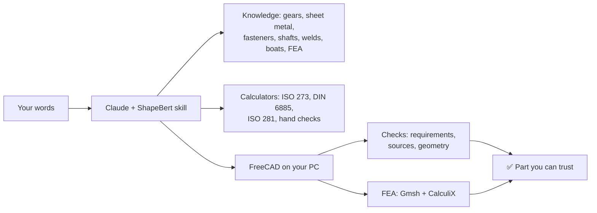

<h1 align="center">ShapeBert</h1>

<p align="center">
  <b>Describe a part. Get it built in FreeCAD, checked against your words, and analysed with FEA you can trust.</b>
</p>

<p align="center">
  <a href="https://github.com/bertwinshine/shapebert-mcp/actions/workflows/tests.yml"></a>
  
  
  
  
</p>

<!--
<p align="center">
  
</p>
-->

---

## ⚡ In one minute

```text
You:  "Steel L-bracket, base 120 x 80 x 10, 4 x M8 holes 15 mm from the long edges,
       wall 80 x 80 x 8 with a 40 mm bore at 50 mm, R6 fillet, two ribs.
       500 N down on the bore. First natural frequency above 150 Hz."
```

ShapeBert then:

- ❓ **asks first** when your words allow two readings (where is the 50 mm measured from?)
- 🧱 **builds** a parametric FreeCAD model, every size in one Params sheet
- ✅ **checks** 17 requirements on the real geometry and **refuses to call it done** while one fails
- 🔎 **catches** what you didn't ask about: M8 holes too close to the edge (15 vs 18 mm), a bolt head touching the fillet
- 📐 **runs FEA** (static + modal), drops the fake stress peak at the bolt hole, and proves the mesh converged
- 🧮 **cross-checks** the FEA against hand formulas and explains every difference
- 📦 **exports** STEP for your CAD or your machinist

---

## 🎯 Why ShapeBert

Most AI-CAD tools stop when a shape appears. ShapeBert keeps going until the shape is **proven** to be what you asked for.

| | ShapeBert |
|---|---|
| ✅ **Your numbers become tests** | "6 x M10 on PCD 100, 12 thick" is stored as checks and re-measured after every change |
| 🏷️ **Every value has a source** | your exact words, a knowledge rule, a calculator, or a flagged default; nothing silently invented |
| 🎯 **Faces by meaning, not number** | loads and fillets go on `top`, `bore`, `-X side`; they stay correct when the part changes |
| 📋 **FEA with its assumptions** | elements, mesh, material, every load and support with its face, solver version, warnings |
| ⚠️ **Honest about singularities** | stress peaks at sharp corners, point loads and fixed faces are flagged, not reported as results |
| 📉 **Convergence, not one guess** | re-solves on finer meshes for displacement *and* stress, and says what settled |
| 🧪 **Validated, with numbers** | textbook cases and published NAFEMS benchmarks, frozen so any drift fails the tests |
| 🔒 **Local and locked down** | runs on your PC, signed requests, free-form code off by default, no telemetry |

---

## 🧪 Proven, not promised

FEA results against known answers ([full table](docs/validation.md)):

| Case | Reference | Error |
|---|---|---|
| Cantilever tip deflection | Beam theory | **0.01 %** |
| Cantilever bending stress | M·c / I | **0.04 %** |
| Bar in tension | F / A | **< 0.01 %** |
| First natural frequency | Euler–Bernoulli | **0.28 %** |
| Euler buckling load | Euler / Engesser | **0.31 %** |
| Heat conduction, free thermal expansion | Fourier, α·ΔT·L | **exact** |
| NAFEMS LE1 elliptic membrane | 92.7 MPa (NAFEMS) | **0.12 %** |
| Plate with a hole | Kirsch, Kt = 3 | **0.7 %** |
| Thick cylinder | Lamé | **0.04 %** |

Model benchmark: 19 engineering prompts, scored automatically ([details](bench/README.md)):

| Model | Score | Cost for all 19 |
|---|---|---|
| Claude Opus | 1.00 | $6.07 |
| Claude Haiku **with ShapeBert's knowledge** | **1.00** | **$0.25** |
| Claude Haiku without it | 0.89 | $0.14 |
| Gemma 4 31B (open weights) | 0.92 – 0.96 | $0.16 |

> The knowledge layer lets a small, cheap model do the work of a large one.

---

## 🔧 How it works



---

## 🚀 Start in 3 steps

You need **FreeCAD 1.1**, **Claude Code** and [uv](https://docs.astral.sh/uv/getting-started/installation/).

1. In Claude Code:
   ```
   /plugin marketplace add bertwinshine/shapebert-mcp
   /plugin install shapebert-mcp@bertwinshine
   ```
2. Ask Claude to run `doctor`, then open the macro path it gives you in FreeCAD and press **Execute**. Restart FreeCAD.
3. Ask for a part: *"a flange, OD 120, 12 thick, 40 bore, six M8 holes on a 90 mm pitch circle"*.

Other setups (FreeCAD Addon Manager, Claude Desktop, manual): [docs/install.md](docs/install.md)

---

## 🔒 Safe by design

- 🏠 Listens on `127.0.0.1` only; every request is HMAC-signed with a local token
- 🚫 Free-form Python **off by default**; when on, FreeCAD shows you every script before it runs
- 📁 File tools stay inside one work folder; no network, no telemetry
- 🏷️ Every tool is labelled read-only, changes-model or can-overwrite, so your AI client can ask you first

Details: [docs/security.md](docs/security.md) · Report a problem: [SECURITY.md](SECURITY.md)

---

## 🧰 What's inside

- **54 tools**: build, check, measure, export, FEA, calculators, knowledge ([full list](docs/tools.md))
- **Domains**: gears and planetary sets · sheet metal · fasteners and fits · shafts, keys, bearings · weldments · LSAM boats · FDM printing · FEA mechanics
- **FEA**: linear static, modal, buckling, steady and transient heat, thermal stress
- **900+ automated tests**, run on Windows and Linux; live FreeCAD tests in CI

---

## 🗺️ Roadmap

- [x] Requirement checks, value sources, face selectors
- [x] FEA with assumptions, convergence and published validation
- [ ] 📄 Build parts from a 2D drawing or photo
- [ ] 🤖 Choose your model: Claude, open models, or local
- [ ] 🧩 Chat panel inside FreeCAD, assemblies, technical drawings

---

## 📜 License

Apache 2.0: use it, change it, ship it, also commercially. Keep the [LICENSE](LICENSE) and [NOTICE](NOTICE).

My own designs and worked examples are kept private and available for collaborations. ⭐ Star the repo if it saves you time, and [open an issue](https://github.com/bertwinshine/shapebert-mcp/issues) with the part you'd like to see built next.
